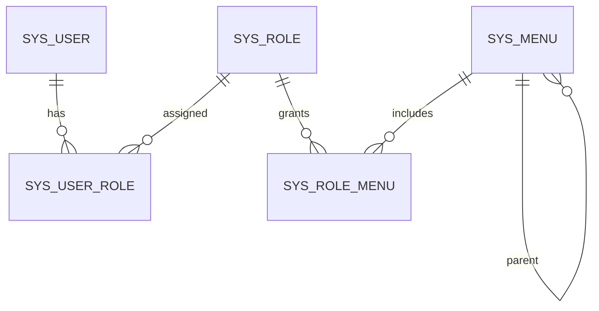

# 数据库设计文档

数据库名称：`manage_system`，字符集：`utf8mb4`，排序规则：`utf8mb4_unicode_ci`。

## 1. 表关系

## 2. 核心表

| 表名 | 用途 | 关键约束 |
|---|---|---|
| `sys_user` | 用户账号和个人资料 | `username` 唯一，密码为 BCrypt 哈希，逻辑删除 |
| `sys_role` | 角色 | `code` 唯一，逻辑删除 |
| `sys_menu` | 菜单与按钮 | `route_name` 唯一，`parent_id + sort` 索引 |
| `sys_announcement` | 系统公告 | 标题、类型、状态、置顶、发布信息，逻辑删除 |
| `sys_operation_log` | 系统日志 | 操作/登录类型、账号、接口、结果、IP、耗时，不保存请求正文 |
| `sys_file` | 文件元数据 | 原始名、随机存储名、类型、大小、上传人，逻辑删除 |
| `sys_message` | 消息正文 | 标题、正文、类型、发送人，逻辑删除 |
| `sys_message_receiver` | 消息接收关系 | 消息、用户、已读时间，联合唯一约束 |
| `sys_user_role` | 用户角色关系 | 联合主键 `(user_id, role_id)` |
| `sys_role_menu` | 角色菜单关系 | 联合主键 `(role_id, menu_id)` |

## 3. 个人资料字段

| 字段 | 类型 | 说明 |
|---|---|---|
| `real_name` | `VARCHAR(50)` | 姓名，V3 迁移时由原昵称初始化 |
| `nickname` | `VARCHAR(50)` | 页面显示昵称 |
| `phone` | `VARCHAR(20)` | 手机号码 |
| `email` | `VARCHAR(100)` | 邮箱地址 |
| `avatar` | `VARCHAR(500)` | 头像访问 URL，由头像上传接口维护 |
| `address` | `VARCHAR(255)` | 兼容历史数据保留，个人中心不再采集或修改 |
| `bio` | `VARCHAR(500)` | 个人简介 |

个人中心隐藏路由存放在 `sys_menu`，路由名为 `UserCenter`，组件为 `/system/user-center`。该路由授权给
`R_SUPER` 和 `R_ADMIN`，不显示在侧边栏，但登录用户可从右上角头像菜单进入。

## 4. 状态枚举

- `sys_user.gender`：`1` 男，`2` 女。
- `sys_user.status`：`1` 启用，`2` 停用。
- `sys_menu.menu_type`：`MENU` 菜单/目录，`BUTTON` 按钮权限。
- `deleted`：`0` 未删除，`1` 已删除。

## 5. 迁移规则

- 表结构以 `backend/src/main/resources/db/migration/` 为唯一迁移源。
- 已发布迁移不可修改，只能追加新版本。
- `sql/手动初始化数据库.sql` 只负责创建空数据库并指向迁移文件，不重复维护表定义。
- `V3__add_user_profile.sql` 新增个人资料字段、个人中心隐藏路由及内置角色授权。
- `V4__add_announcement_management.sql` 新增公告表、公告管理菜单、按钮权限和模板公告。

## 6. 公告表字段

| 字段 | 类型 | 说明 |
|---|---|---|
| `id` | `BIGINT UNSIGNED` | 公告主键 |
| `title` | `VARCHAR(150)` | 公告标题 |
| `content` | `TEXT` | 公告正文，按纯文本存储 |
| `type` | `VARCHAR(20)` | `SYSTEM`、`ACTIVITY`、`REMINDER` |
| `status` | `VARCHAR(20)` | `DRAFT`、`PUBLISHED` |
| `is_top` | `TINYINT(1)` | 是否置顶 |
| `published_by` | `VARCHAR(30)` | 最近一次发布人 |
| `published_at` | `DATETIME` | 最近一次发布时间 |
| `created_by` / `updated_by` | `VARCHAR(30)` | 创建人和更新人 |
| `created_at` / `updated_at` | `DATETIME` | 创建和更新时间 |
| `deleted` | `TINYINT` | 逻辑删除标记 |

索引覆盖状态、类型、置顶和发布时间组合查询，满足公告筛选及默认排序。

## 7. 日志、文件和消息表

### 7.1 `sys_operation_log`

日志表使用 `log_type` 区分 `OPERATION` 和 `LOGIN`，并保存 `username`、`method`、`path`、
`query_params`、`status_code`、`success`、`ip_address`、`user_agent`、`duration_ms` 和 `created_at`。
不保存请求体，按日志类型和创建时间、账号、方法和结果建立索引。

### 7.2 `sys_file`

文件表保存 `original_name`、`storage_name`、`content_type`、`file_size`、`uploader`、时间字段和逻辑删除标记。
`storage_name` 全局唯一；数据库不保存用户提供的绝对路径。

### 7.3 `sys_message` 与 `sys_message_receiver`

消息正文与接收状态分表保存。一条消息可关联多个接收人，`(message_id, user_id)` 唯一；接收表通过
`read_at` 判断是否已读。查询收件箱时同时限定接收人 ID 和未删除消息。

## 8. V5 迁移

`V5__add_log_file_message_modules.sql` 创建上述四张表，新增日志管理、文件管理和消息通知动态菜单及按钮权限，
并为两个内置用户写入一条欢迎消息。日志菜单仅授权 `R_SUPER`，文件和消息菜单授权 `R_SUPER`、`R_ADMIN`。

## 9. V6 迁移

`V6__merge_login_and_operation_logs.sql` 为 `sys_operation_log` 增加 `log_type` 字段和组合索引，历史记录默认标记为
`OPERATION`；同时把动态菜单标题调整为“日志管理”。

## 1.1.0 数据库变更

新增 `V7__add_auth_sessions.sql`，V1～V6 保持原样。

- `sys_user.token_version`：非空 BIGINT，默认0。通过原子增量 SQL 撤销令牌，普通实体更新不能覆盖该字段。
- `sys_auth_session`：会话 ID、用户 ID、刷新令牌 SHA-256 摘要、绝对到期时间、创建和更新时间。对用户和到期时间建立索引。数据库不保存原始令牌。
- 刷新通过 `旧摘要 + 会话ID + 用户ID + 未过期` 条件更新，只有一个并发请求能成功。退出删除当前会话；过期会话在登录时清理。
- 已注销用户名、已删除角色编码和路由名称继续保留。业务层查询包含逻辑删除记录，避免先通过校验再触发唯一索引错误。
- 公告发布人、发布时间及个人资料手机号、简介允许明确写入 NULL，其余字段不全局改变更新策略。
