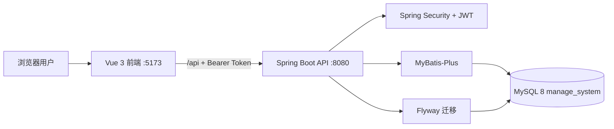

# 概要设计说明书

## 1. 总体架构

## 2. 前端设计

- 复用 Art Design Pro 的布局、组件、主题和动态路由机制。
- `src/api/` 作为唯一接口请求层。
- Axios 统一追加 `Authorization: Bearer <token>`。
- `VITE_ACCESS_MODE=backend`，菜单和按钮权限由后端返回。
- 系统管理页只消费真实接口，不再使用 Apifox Mock 或本地角色数据。
- 公告管理复用系统管理分页表格和动态按钮权限，后端独立维护公告状态、发布信息和逻辑删除。
- 系统操作日志与登录日志通过 Web 拦截器统一采集并写入同一张表，不采集请求正文或密码；日志管理页通过横向入口切换，单次只展示一种日志内容。
- 文件管理由数据库元数据与本地专用存储目录组成，原始文件名不参与物理路径生成。
- 消息通知采用消息正文与接收状态分表，顶部通知面板和消息中心消费同一组真实接口。

## 3. 后端分层

| 层级 | 职责 |
|---|---|
| Controller | 参数接收、权限声明、统一响应 |
| Service | 定义业务能力接口，供 Controller、拦截器和其他业务模块依赖 |
| ServiceImpl | 实现业务规则、事务和对象转换，统一位于 `service/impl/` |
| Mapper | MyBatis-Plus 数据访问和必要的关联查询 |
| Entity | 数据库表实体 |
| DTO/VO | 请求和响应模型 |
| Security | JWT、认证过滤器、当前用户上下文 |
| Common | 统一响应、错误码、异常层次、错误追踪信息和全局异常处理 |

业务层遵循接口与实现分离原则：`service/` 保存 `XxxService` 接口，`service/impl/` 保存带
`@Service` 的 `XxxServiceImpl` 实现。上层组件只注入接口，避免直接依赖具体实现。

## 4. 权限模型

采用 RBAC：用户关联角色，角色关联菜单或按钮。角色编码作为后端管理接口的粗粒度权限；按钮节点
用于前端操作入口控制。前端隐藏按钮不等于安全控制，后端 `@PreAuthorize` 是最终权限边界。

## 5. 数据初始化

Flyway 管理版本化迁移：

- `V1__init_schema.sql`：创建五张核心表、索引和外键。
- `V2__seed_data.sql`：创建初始用户、角色、菜单和授权关系。

已有迁移文件发布后不修改；后续结构变化新增 `V3__*.sql`。

## 1.1.0 架构补充

业务权限由菜单树生成模块权限并在服务端逐接口校验，角色与菜单授权管理保留超级管理员边界。JWT只承载身份、会话ID和撤销版本，刷新摘要和绝对期限保存在MySQL会话表中。普通业务请求同时验证账号状态、版本和会话，权限随数据库授权变化生效。

文件系统不参与数据库事务；通过回滚补偿和提交后清理减少不一致，失败日志交由运维重试。前端保留现有API层，增加一次刷新、同会话重试和跨会话请求阻断。
